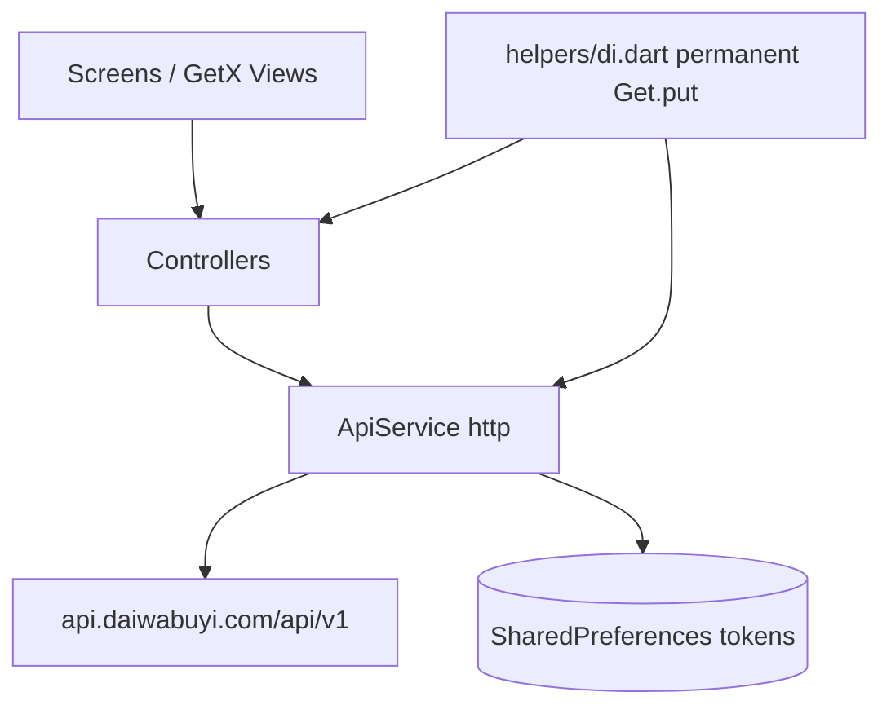
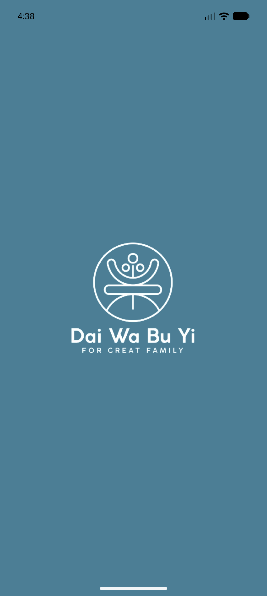
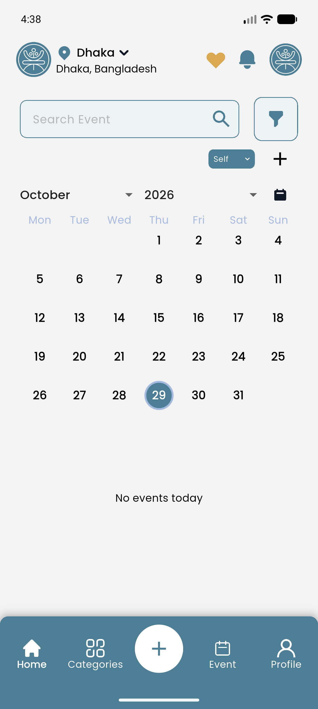
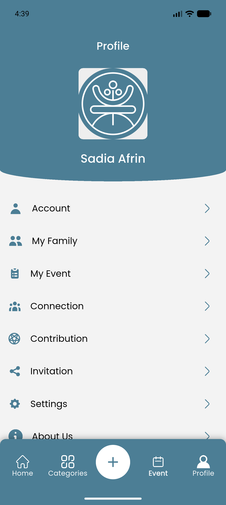
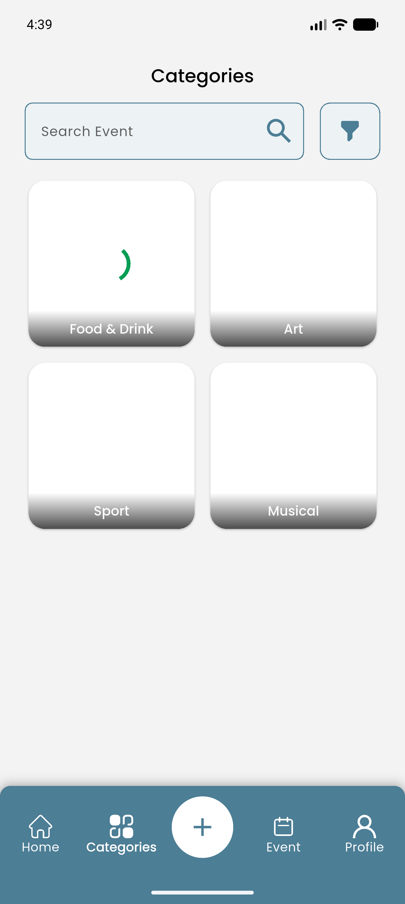
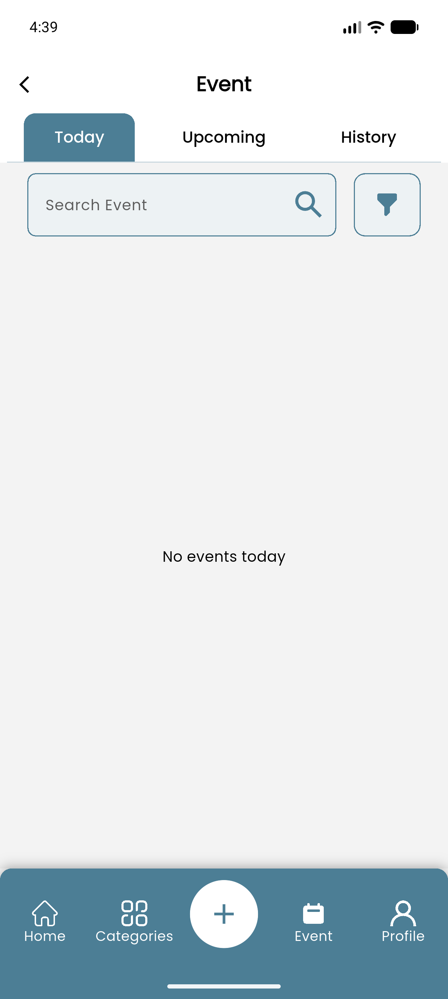
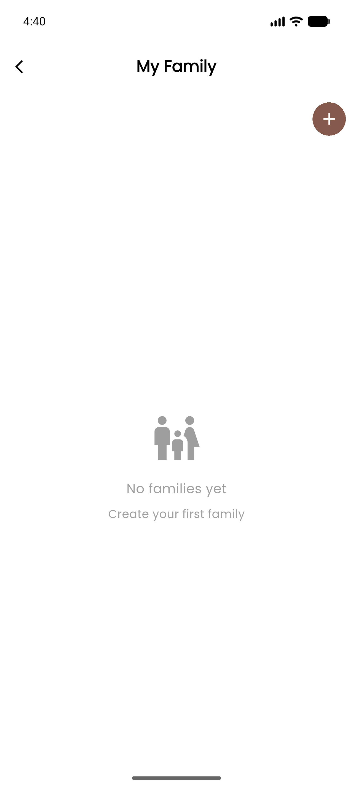
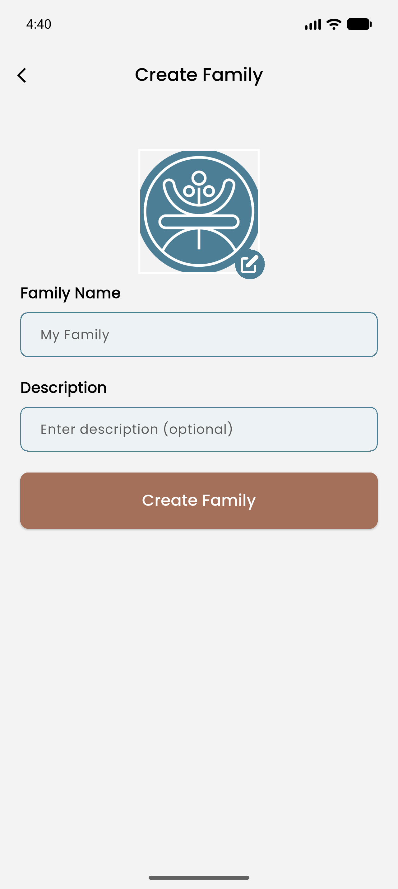
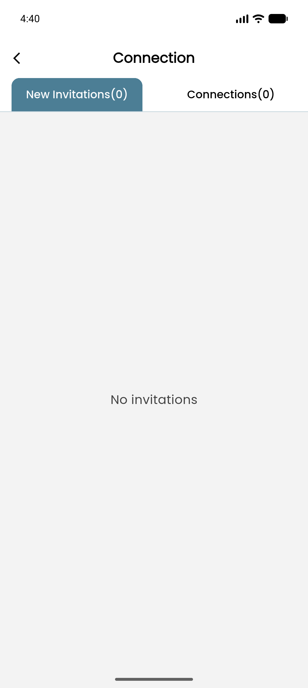
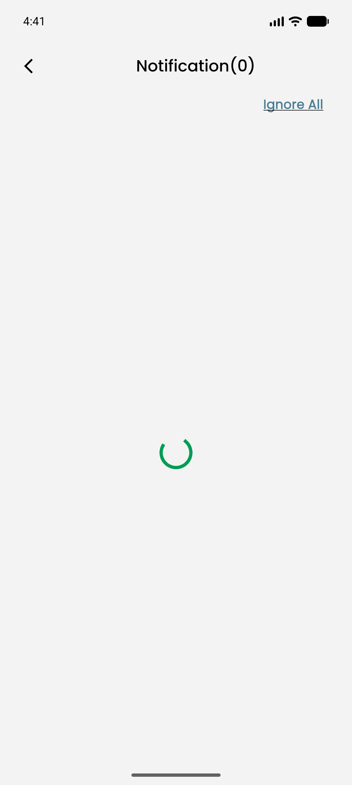

# Dai Wa Bu Yi (Event-Sharing) — Testing Report

| Field | Value |
|-------|-------|
| **App** | Dai Wa Bu Yi (`event_sharing`) |
| **Package** | `com.gehzi.event_sharing` |
| **Version** | 1.0.0+1 |
| **Platform tested** | Android Emulator (`emulator-5554`, Android 17) |
| **Logged-in user (session)** | Sadia Afrin |
| **Backend base** | `https://api.daiwabuyi.com/api/v1` |
| **Report date** | 29 Oct 2026 |
| **Report type** | Code review + exploratory UI testing on emulator |
| **Automated unit tests** | None found (`test/` empty) |

---

## 1. Executive summary

The Flutter client is a **GetX** app talking to a REST API under `/api/v1`. Core modules (Auth, Home feeds, Profile, Family, Events, Connections, Invitations, Contributions, Notifications, Settings) are implemented in UI and controllers.

**Overall readiness: Beta / UAT-ready with blockers**

| Area | Verdict |
|------|---------|
| Auth + session splash | Pass (session restored to Home) |
| Home / empty states | Pass |
| Categories | Partial (images often missing / loading) |
| My Events tabs | Pass (empty state OK) |
| Profile menu | Pass |
| My Family list | Pass (empty state) / Create Family UI Pass |
| Add family member API wiring | Implemented in code — needs end-to-end API verify |
| Connections / Notifications | Partial (empty / long loading) |
| Logout | **Fail** (does not clear tokens / call logout API) |
| Remove family member | **Fail risk** (double-slash URL) |
| Token refresh | **Not implemented** |
| Payments / Wallet | Stub / incomplete |
| Donation payment | UI only (no gateway) |

---

## 2. Architecture & backend design (as used by the app)



### 2.1 Layers

| Layer | Path | Role |
|-------|------|------|
| Bootstrap | `lib/main.dart` | Portrait, `di.init()`, GetMaterialApp |
| DI | `lib/helpers/di.dart` | Permanent controllers + `ApiService` |
| Routes | `lib/helpers/route.dart` | `AppRoutes` + `GetPage` list |
| HTTP | `lib/services/api_service.dart` | GET/POST/PUT/PATCH/DELETE + multipart, Bearer auth |
| Endpoints | `lib/utils/api_constants.dart` | All `/api/v1/...` paths |
| State | `lib/controllers/*.dart` | Feature logic + API calls |
| UI | `lib/views/screen/**` | Feature screens |

### 2.2 API module map

| Module | Key endpoints |
|--------|----------------|
| **Auth** | `/auth/register`, `/auth/verify-email`, `/auth/login`, `/auth/forgot-password`, `/auth/verify-forgot-password-otp`, `/auth/reset-password`, `/auth/change-password`, `/auth/logout` *(constant unused by UI logout)* |
| **Users** | `/users/me`, `/users/update-me`, `/users/check-username`, `/users/edit-options`, `/users/:userId` |
| **Families** | `GET/POST /families`, `GET/PATCH/DELETE /families/:familyId` |
| **Family members** | `POST /family-members`, `GET /family-members/family/:familyId`, `?role=OWNER`, `POST /family-members/add-owner`, `DELETE ...` *(bug)* |
| **Events** | `POST /events`, `PATCH /events/:eventId`, feeds: `today`, `upcoming`, `history`, `search`, `by-family-relation` |
| **Home events** | `GET/POST /home-events` |
| **Applications** | `GET /event-applications/my` |
| **Connections** | received / accept / reject / my-connections / remove |
| **Invitations** | share / sent / received / accept / decline |
| **Contributions** | `/contributions`, `/contributions/filter-options` |
| **Notifications** | `/notifications/my`, read-all |
| **Settings** | `/user-settings`, CMS `/settings/about|terms|privacy` |
| **Categories** | `/categories`, `/subcategories`, `/programs` |

### 2.3 Auth / session design

```
Splash → token present?
  yes → GET /users/me
        OK → Home
        Token expired/Unauthorized → clear prefs → Sign In
        other error → still Home (soft fail)
  no  → Onboarding → Sign In / Sign Up
```

Tokens stored in SharedPreferences (`access_token`, `refresh_token`, expiry keys).  
**`/auth/refresh` is defined but never used** — no 401 refresh interceptor.

### 2.4 Family member create contract (client)

`POST /family-members`

```json
{
  "familyId": "<uuid>",
  "firstName": "...",
  "lastName": "...",
  "gender": "MALE|FEMALE",
  "birthDate": "YYYY-MM-DD",
  "location": "...",
  "country": "...",
  "state": "...",
  "city": "...",
  "email": "...",
  "password": "...",
  "username": "...",
  "relationShip": "Spous|ChildStephanie|ChildSophia|Other",
  "skills": ["..."],
  "isIndependent": false,
  "role": "MEMBER"
}
```

Screen: `CreateMemberProfileScreen` → `FamilyController.addFamilyMember`.

---

## 3. Screenshots (emulator session)

> Captured on device session for user **Sadia Afrin**, location **Dhaka**.

### 3.1 Splash



| ID | Result | Notes |
|----|--------|-------|
| TC-SPL-01 | **Pass** | Brand splash “Dai Wa Bu Yi / FOR GREAT FAMILY” shows |

### 3.2 Home



| ID | Result | Notes |
|----|--------|-------|
| TC-HOME-01 | **Pass** | Session restored to Home after splash |
| TC-HOME-02 | **Pass** | Calendar (Oct 2026), Self filter, search, empty “No events today” |
| TC-HOME-03 | **Pass** | Bottom nav: Home / Categories / + / Event / Profile |

### 3.3 Profile



| ID | Result | Notes |
|----|--------|-------|
| TC-PROF-01 | **Pass** | Profile header shows name “Sadia Afrin” |
| TC-PROF-02 | **Pass** | Menu: Account, My Family, My Event, Connection, Contribution, Invitation, Settings, About Us |

### 3.4 Categories



| ID | Result | Notes |
|----|--------|-------|
| TC-CAT-01 | **Pass** | Categories list loads (Food & Drink, Art, Sport, Musical) |
| TC-CAT-02 | **Fail / Partial** | Category images often blank or stuck on spinner |

### 3.5 My Events (bottom nav)



| ID | Result | Notes |
|----|--------|-------|
| TC-EVT-01 | **Pass** | Tabs Today / Upcoming / History |
| TC-EVT-02 | **Pass** | Empty state “No events today” |
| TC-EVT-03 | **Info** | Profile → “My Event” opens **applied applications** list (`/event-applications/my`), not this tabbed screen — product inconsistency |

### 3.6 My Family



| ID | Result | Notes |
|----|--------|-------|
| TC-FAM-01 | **Pass** | Empty state: “No families yet / Create your first family” |
| TC-FAM-02 | **Partial** | Brief spinner before empty state (acceptable) |

### 3.7 Create Family



| ID | Result | Notes |
|----|--------|-------|
| TC-FAM-03 | **Pass** | Create Family UI: image, name, description, CTA |
| TC-FAM-04 | **Pending** | End-to-end create + list refresh not fully verified this session (camera/permission interruption) |

### 3.8 Connections



| ID | Result | Notes |
|----|--------|-------|
| TC-CON-01 | **Pass** | Tabs New Invitations / Connections with counts |
| TC-CON-02 | **Pass** | Empty “No invitations” |
| TC-CON-03 | **Fail / Gap** | No UI to **send** connection request (`createConnections` / suggestions constants unused) |

### 3.9 Notifications



| ID | Result | Notes |
|----|--------|-------|
| TC-NOT-01 | **Partial** | Title `Notification(0)` + “Ignore All” visible |
| TC-NOT-02 | **Fail / Flaky** | Observed long green spinner while count shows 0 — loading UX issue |

---

## 4. Full test matrix (code + UI)

### 4.1 Authentication

| ID | Case | Expected | Result |
|----|------|----------|--------|
| TC-AUTH-01 | Splash with valid token | Home | **Pass** (observed) |
| TC-AUTH-02 | Splash with no token | Onboarding | Code path OK — not re-tested this session |
| TC-AUTH-03 | Register → OTP → Home | Success | Code wired — **Pending live OTP** |
| TC-AUTH-04 | Login wrong password | Error toast | **Pending** |
| TC-AUTH-05 | Forgot → OTP → Reset | Sign In | Code wired; screen naming confusing — **Pending** |
| TC-AUTH-06 | Logout from Profile | Clear session + Sign In + revoke token | **Fail** — only `Get.offAllNamed(signIn)`; tokens remain; `/auth/logout` not called |

### 4.2 Family

| ID | Case | Expected | Result |
|----|------|----------|--------|
| TC-FAM-10 | List families | Paginated list or empty | **Pass** (empty) |
| TC-FAM-11 | Create family | POST `/families` then list updates | UI **Pass**; E2E **Pending** |
| TC-FAM-12 | Open family → Member / Owner tabs | Members load | **Pending** (no family in session) |
| TC-FAM-13 | Add member (Create Profile) | POST `/family-members` body contract | **Code Pass**; E2E **Pending** |
| TC-FAM-14 | relationShip values | Spous / ChildStephanie / ChildSophia / Other | Code **Pass** |
| TC-FAM-15 | Make owner | POST `/family-members/add-owner` | Code **Pass**; E2E **Pending** |
| TC-FAM-16 | Remove member | DELETE succeeds | **Fail risk** — URL has `family-members//family` double slash |

### 4.3 Events

| ID | Case | Expected | Result |
|----|------|----------|--------|
| TC-EVT-10 | Home today / upcoming / relation feeds | Lists or empty | **Pass** (empty) |
| TC-EVT-11 | Create event multi-step | Multipart POST `/events` | Code present; UI **Pending** this session |
| TC-EVT-12 | Edit / verify event | Multipart PATCH | Code present — **Pending** |
| TC-EVT-13 | Applied events (Profile My Event) | `/event-applications/my` | **Pending** |

### 4.4 Profile & settings

| ID | Case | Expected | Result |
|----|------|----------|--------|
| TC-SET-01 | Edit profile | PATCH/multipart update-me | Code **Pass** — **Pending** UI |
| TC-SET-02 | Change password | POST change-password | Code **Pass** — **Pending** |
| TC-SET-03 | User settings | GET/PATCH user-settings | Code **Pass** — **Pending** |
| TC-SET-04 | About / Terms / Privacy | CMS settings endpoints | Code **Pass** — **Pending** |

### 4.5 Incomplete / stub modules

| Module | Status |
|--------|--------|
| Wallet | Empty scaffold |
| Donation → Make Payment | Navigates to success **without** payment API |
| Connection create / suggest | Constants only |
| Token refresh | Constant only |
| Delete account | Constant only |
| `lib/views/screen/dump/` | Legacy commented screens |

---

## 5. Defects & risks (priority)

### P0 — Blockers

| # | Issue | Evidence | Recommendation |
|---|-------|----------|----------------|
| D1 | **Logout does not clear auth** | `profile_screen.dart` → `Get.offAllNamed(signIn)` only | Call `AuthController.logout()` / `clearUserData()` + `POST /auth/logout` |
| D2 | **Remove member URL double slash** | `ApiConstants.removeFamilyMember = '.../family-members//family/...'` | Fix to single `/family-members/family/:familyId/user/:userId` |
| D3 | **No refresh-token handling** | `refreshToken` unused; 401 not recovered | Add refresh interceptor or forced re-login |

### P1 — High

| # | Issue | Recommendation |
|---|-------|----------------|
| D4 | Category / media images often blank | Verify CDN URLs + `CachedNetworkImage` error placeholders |
| D5 | Notifications spinner vs count `(0)` | Stop loading when empty list returns; fix hanging request |
| D6 | Profile “My Event” ≠ bottom-nav Event | Align naming or destinations |
| D7 | Forgot-password screens misnamed | Rename for maintainability |
| D8 | Splash soft-fail opens Home on network errors | Prefer offline banner or Sign In |

### P2 — Medium

| # | Issue | Recommendation |
|---|-------|----------------|
| D9 | `relationShip` typo `Spous` (API contract) | Keep if backend requires; document |
| D10 | Payment / wallet stubs | Hide entry or mark “Coming soon” |
| D11 | Duplicate `ApiService` lazyPut on categories search route | Remove; use DI singleton |
| D12 | Verbose `print` debug in auth/family | Remove for release |
| D13 | No automated tests | Add widget/API smoke tests |

---

## 6. Suggested UAT checklist (manual)

1. **Auth:** Register → OTP → Home; Login; Forgot → Reset; Logout → relaunch (must ask login).
2. **Family:** Create family → open → Add member with full body → appear in Member tab → Make Owner → Remove member.
3. **Events:** Create 4-step event → appear in Home/Upcoming → edit → applied list.
4. **Social:** Accept/reject connection; share invitation; accept/decline invitation.
5. **Profile:** Edit photo + fields; change password; settings save.
6. **Negative:** Invalid email, mismatched password, empty required fields, expired token.

---

## 7. Environment notes

- Emulator package installed: `com.gehzi.event_sharing`
- Screenshots folder: `docs/testing_report/screenshots/`
- Client stack: Flutter 3.41.x, GetX, `http`, SharedPreferences, ScreenUtil
- i18n assets: `en`, `ar`, `es`
- Theme forced **light** in `main.dart`

---

## 8. Conclusion

The app has a **coherent GetX + REST architecture** and most primary screens render with correct empty states. Family member create is **wired in code** to the documented `/family-members` contract.

Before production / final client UAT sign-off, fix **logout session leak**, **remove-member URL**, and **token refresh**; complete E2E passes for Family create → Add member → Events create; and either finish or hide payment/wallet stubs.

**Signed off as:** Exploratory QA + static code review (not a full regression suite).
